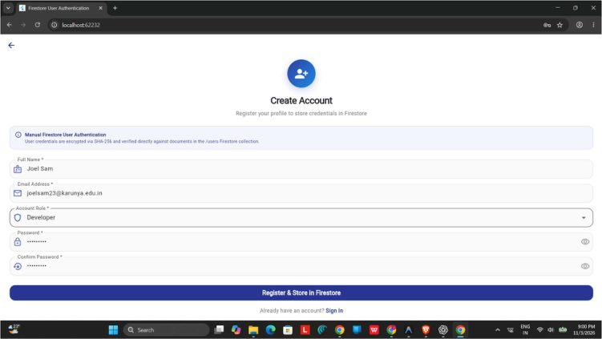
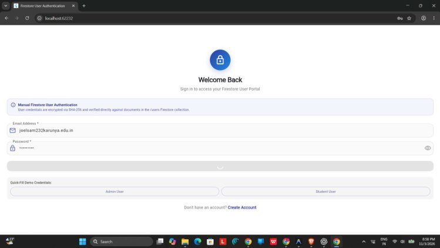

# Ex. No. 10: Firestore Authentication User Portal

Kevin Kattakayam | URK23CS7081  
24CS2016 - Building Applications using Flutter  
Date of Exercise: 2026-10-12  
Github Code Link (Keep as public): https://github.com/Kevin-Kattakayam/exp10

## Aim

To develop a Flutter registration and login flow that stores user profile records in Firestore and opens a dashboard after successful sign-in.

## Description

The app contains registration, login, and dashboard screens. Registration validates a name, email, role, and password, checks whether the email already exists, hashes the password with SHA-256, and stores the user record through the Firestore authentication service. Login checks the submitted credentials, updates the last-login time, and passes the authenticated AppUser to the dashboard. The dashboard displays profile and role information and provides logout. Demo users and a local fallback are included in the service.

## Program

### lib/main.dart

```dart
import 'package:flutter/material.dart';
import 'screens/login_screen.dart';
import 'services/firestore_auth_service.dart';

void main() async {
  WidgetsFlutterBinding.ensureInitialized();

  // Initialize Firebase and Cloud Firestore
  await FirestoreAuthService.instance.initialize();

  runApp(const FirestoreAuthApp());
}

/// Root widget for the Manual User Login Authentication app.
class FirestoreAuthApp extends StatelessWidget {
  const FirestoreAuthApp({super.key});

  @override
  Widget build(BuildContext context) {
    return MaterialApp(
      title: 'Firestore User Authentication',
      debugShowCheckedModeBanner: false,
      theme: ThemeData(
        colorSchemeSeed: Colors.indigo,
        useMaterial3: true,
      ),
      home: const LoginScreen(),
    );
  }
}
```

### lib/firebase_options.dart

```dart
import 'package:firebase_core/firebase_core.dart' show FirebaseOptions;
import 'package:flutter/foundation.dart'
    show defaultTargetPlatform, kIsWeb, TargetPlatform;

/// Default [FirebaseOptions] for Firestore Manual User Login app.
class DefaultFirebaseOptions {
  static FirebaseOptions get currentPlatform {
    if (kIsWeb) return web;
    switch (defaultTargetPlatform) {
      case TargetPlatform.android:
        return android;
      case TargetPlatform.iOS:
        return ios;
      case TargetPlatform.macOS:
        return macos;
      case TargetPlatform.windows:
        return windows;
      case TargetPlatform.linux:
        throw UnsupportedError(
          'DefaultFirebaseOptions have not been configured for linux.',
        );
      default:
        return android;
    }
  }

  static const FirebaseOptions web = FirebaseOptions(
    apiKey: 'AIzaSyDemoFirestoreApiKeyWebExp1012345',
    appId: '1:123456789012:web:abcdef1234567890abcdef',
    messagingSenderId: '123456789012',
    projectId: 'firestore-auth-lab-exp10',
    authDomain: 'firestore-auth-lab-exp10.firebaseapp.com',
    storageBucket: 'firestore-auth-lab-exp10.appspot.com',
  );

  static const FirebaseOptions android = FirebaseOptions(
    apiKey: 'AIzaSyDemoFirestoreApiKeyAndroidExp101',
    appId: '1:123456789012:android:abcdef1234567890abcd',
    messagingSenderId: '123456789012',
    projectId: 'firestore-auth-lab-exp10',
    storageBucket: 'firestore-auth-lab-exp10.appspot.com',
  );

  static const FirebaseOptions ios = FirebaseOptions(
    apiKey: 'AIzaSyDemoFirestoreApiKeyIosExp1012345',
    appId: '1:123456789012:ios:abcdef1234567890abcdef',
    messagingSenderId: '123456789012',
    projectId: 'firestore-auth-lab-exp10',
    storageBucket: 'firestore-auth-lab-exp10.appspot.com',
    iosBundleId: 'com.example.firestoreAuthApp',
  );

  static const FirebaseOptions macos = FirebaseOptions(
    apiKey: 'AIzaSyDemoFirestoreApiKeyMacosExp1012',
    appId: '1:123456789012:ios:abcdef1234567890abcdef',
    messagingSenderId: '123456789012',
    projectId: 'firestore-auth-lab-exp10',
    storageBucket: 'firestore-auth-lab-exp10.appspot.com',
    iosBundleId: 'com.example.firestoreAuthApp',
  );

  static const FirebaseOptions windows = FirebaseOptions(
    apiKey: 'AIzaSyDemoFirestoreApiKeyWinExp101234',
    appId: '1:123456789012:web:abcdef1234567890abcdef',
    messagingSenderId: '123456789012',
    projectId: 'firestore-auth-lab-exp10',
    storageBucket: 'firestore-auth-lab-exp10.appspot.com',
  );
}
```

### lib/models/app_user.dart

```dart
import 'dart:convert';
import 'package:crypto/crypto.dart';

/// Data model representing a User document stored in the Firestore 'users' collection.
class AppUser {
  final String? id; // Firestore document ID
  final String email;
  final String passwordHash;
  final String fullName;
  final String role; // 'Administrator', 'Developer', 'Student', 'Staff'
  final String createdAt;
  final String lastLoginAt;

  const AppUser({
    this.id,
    required this.email,
    required this.passwordHash,
    required this.fullName,
    required this.role,
    required this.createdAt,
    required this.lastLoginAt,
  });

  /// Hash password using SHA-256 for secure Firestore storage.
  static String hashPassword(String password) {
    final bytes = utf8.encode(password);
    final digest = sha256.convert(bytes);
    return digest.toString();
  }

  /// Verify candidate password against stored SHA-256 hash.
  bool verifyPassword(String candidatePassword) {
    return passwordHash == hashPassword(candidatePassword);
  }

  /// Convert to Firestore document map.
  Map<String, dynamic> toFirestore() {
    return {
      'email': email.toLowerCase().trim(),
      'passwordHash': passwordHash,
      'fullName': fullName.trim(),
      'role': role,
      'createdAt': createdAt,
      'lastLoginAt': lastLoginAt,
    };
  }

  /// Factory constructor to parse document data and document ID from Firestore.
  factory AppUser.fromMap(Map<String, dynamic> map, String id) {
    return AppUser(
      id: id,
      email: map['email'] as String? ?? '',
      passwordHash: map['passwordHash'] as String? ?? '',
      fullName: map['fullName'] as String? ?? 'User',
      role: map['role'] as String? ?? 'Member',
      createdAt: map['createdAt'] as String? ?? DateTime.now().toIso8601String(),
      lastLoginAt: map['lastLoginAt'] as String? ?? DateTime.now().toIso8601String(),
    );
  }

  AppUser copyWith({
    String? id,
    String? email,
    String? passwordHash,
    String? fullName,
    String? role,
    String? createdAt,
    String? lastLoginAt,
  }) {
    return AppUser(
      id: id ?? this.id,
      email: email ?? this.email,
      passwordHash: passwordHash ?? this.passwordHash,
      fullName: fullName ?? this.fullName,
      role: role ?? this.role,
      createdAt: createdAt ?? this.createdAt,
      lastLoginAt: lastLoginAt ?? this.lastLoginAt,
    );
  }
}
```

### lib/screens/dashboard_screen.dart

```dart
import 'package:flutter/material.dart';
import '../models/app_user.dart';
import '../services/firestore_auth_service.dart';
import 'login_screen.dart';

/// Screen displayed after successful manual authentication against Firestore.
class DashboardScreen extends StatelessWidget {
  final AppUser user;

  const DashboardScreen({super.key, required this.user});

  void _logout(BuildContext context) {
    FirestoreAuthService.instance.logout();
    Navigator.pushAndRemoveUntil(
      context,
      MaterialPageRoute(builder: (_) => const LoginScreen()),
      (route) => false,
    );
  }

  @override
  Widget build(BuildContext context) {
    return Scaffold(
      backgroundColor: const Color(0xFFF7F8FA),
      appBar: AppBar(
        title: const Text(
          'User Portal Dashboard',
          style: TextStyle(fontWeight: FontWeight.bold),
        ),
        backgroundColor: Colors.indigo[800],
        foregroundColor: Colors.white,
        elevation: 0,
        actions: [
          IconButton(
            icon: const Icon(Icons.logout),
            tooltip: 'Sign Out',
            onPressed: () => _logout(context),
          ),
        ],
      ),
      body: SingleChildScrollView(
        padding: const EdgeInsets.all(20),
        child: Column(
          crossAxisAlignment: CrossAxisAlignment.stretch,
          children: [
            // User Profile Hero Card
            Card(
              elevation: 3,
              shape: RoundedRectangleBorder(borderRadius: BorderRadius.circular(20)),
              child: Container(
                decoration: BoxDecoration(
                  borderRadius: BorderRadius.circular(20),
                  gradient: LinearGradient(
                    colors: [
                      Colors.indigo[800]!,
                      Colors.blue[700]!,
                    ],
                    begin: Alignment.topLeft,
                    end: Alignment.bottomRight,
                  ),
                ),
                padding: const EdgeInsets.all(24),
                child: Column(
                  children: [
                    CircleAvatar(
                      radius: 36,
                      backgroundColor: Colors.white.withValues(alpha: 0.2),
                      child: Text(
                        _getInitials(user.fullName),
                        style: const TextStyle(
                          fontSize: 24,
                          fontWeight: FontWeight.bold,
                          color: Colors.white,
                        ),
                      ),
                    ),
                    const SizedBox(height: 14),
                    Text(
                      user.fullName,
                      style: const TextStyle(
                        fontSize: 22,
                        fontWeight: FontWeight.bold,
                        color: Colors.white,
                      ),
                    ),
                    const SizedBox(height: 4),
                    Text(
                      user.email,
                      style: TextStyle(
                        fontSize: 14,
                        color: Colors.blue[100],
                      ),
                    ),
                    const SizedBox(height: 12),
                    Container(
                      padding: const EdgeInsets.symmetric(horizontal: 14, vertical: 4),
                      decoration: BoxDecoration(
                        color: Colors.white.withValues(alpha: 0.2),
                        borderRadius: BorderRadius.circular(20),
                      ),
                      child: Row(
                        mainAxisSize: MainAxisSize.min,
                        children: [
                          const Icon(Icons.verified_user, color: Colors.greenAccent, size: 15),
                          const SizedBox(width: 6),
                          Text(
                            user.role,
                            style: const TextStyle(
                              color: Colors.white,
                              fontSize: 12,
                              fontWeight: FontWeight.bold,
                            ),
                          ),
                        ],
                      ),
                    ),
                  ],
                ),
              ),
            ),
            const SizedBox(height: 18),

            // Authentication & Firestore Security Overview
            Card(
              elevation: 1,
              shape: RoundedRectangleBorder(borderRadius: BorderRadius.circular(16)),
              child: Padding(
                padding: const EdgeInsets.all(18),
                child: Column(
                  crossAxisAlignment: CrossAxisAlignment.start,
                  children: [
                    const Row(
                      children: [
                        Icon(Icons.shield_outlined, color: Colors.indigo),
                        SizedBox(width: 8),
                        Text(
                          'Firestore Authentication Session',
                          style: TextStyle(
                            fontSize: 16,
                            fontWeight: FontWeight.bold,
                          ),
                        ),
                      ],
                    ),
                    const Divider(height: 24),
                    _buildSessionItem(
                      label: 'Firestore Document ID',
                      value: '/users/${user.id ?? "local_cache"}',
                      isMonospace: true,
                    ),
                    const SizedBox(height: 12),
                    _buildSessionItem(
                      label: 'Authentication Mechanism',
                      value: 'SHA-256 Manual Hash Verification',
                    ),
                    const SizedBox(height: 12),
                    _buildSessionItem(
                      label: 'Account Created',
                      value: user.createdAt,
                    ),
                    const SizedBox(height: 12),
                    _buildSessionItem(
                      label: 'Last Successful Login',
                      value: user.lastLoginAt,
                    ),
                  ],
                ),
              ),
            ),
            const SizedBox(height: 24),

            // Sign Out Button
            OutlinedButton.icon(
              onPressed: () => _logout(context),
              icon: const Icon(Icons.logout, color: Colors.redAccent),
              label: const Text(
                'Sign Out from Session',
                style: TextStyle(color: Colors.redAccent, fontWeight: FontWeight.bold),
              ),
              style: OutlinedButton.styleFrom(
                side: const BorderSide(color: Colors.redAccent),
                padding: const EdgeInsets.symmetric(vertical: 14),
                shape: RoundedRectangleBorder(borderRadius: BorderRadius.circular(12)),
              ),
            ),
          ],
        ),
      ),
    );
  }

  Widget _buildSessionItem({
    required String label,
    required String value,
    bool isMonospace = false,
  }) {
    return Column(
      crossAxisAlignment: CrossAxisAlignment.start,
      children: [
        Text(
          label,
          style: TextStyle(fontSize: 12, color: Colors.grey[600]),
        ),
        const SizedBox(height: 2),
        Text(
          value,
          style: TextStyle(
            fontSize: 13,
            fontWeight: FontWeight.bold,
            fontFamily: isMonospace ? 'monospace' : null,
            color: isMonospace ? Colors.indigo[800] : Colors.grey[900],
          ),
        ),
      ],
    );
  }

  String _getInitials(String name) {
    final parts = name.trim().split(RegExp(r'\s+'));
    if (parts.length >= 2) {
      return '${parts[0][0]}${parts[1][0]}'.toUpperCase();
    } else if (parts.isNotEmpty && parts[0].isNotEmpty) {
      return parts[0].substring(0, parts[0].length >= 2 ? 2 : 1).toUpperCase();
    }
    return 'US';
  }
}
```

### lib/screens/login_screen.dart

```dart
import 'package:flutter/material.dart';
import '../services/firestore_auth_service.dart';
import '../widgets/auth_header.dart';
import '../widgets/custom_auth_field.dart';
import '../widgets/firestore_auth_banner.dart';
import 'dashboard_screen.dart';
import 'register_screen.dart';

/// Screen allowing users to sign in by querying credentials stored in Google Cloud Firestore.
class LoginScreen extends StatefulWidget {
  const LoginScreen({super.key});

  @override
  State<LoginScreen> createState() => _LoginScreenState();
}

class _LoginScreenState extends State<LoginScreen> {
  final _formKey = GlobalKey<FormState>();

  final _emailController = TextEditingController();
  final _passwordController = TextEditingController();

  bool _obscurePassword = true;
  bool _isLoading = false;

  @override
  void dispose() {
    _emailController.dispose();
    _passwordController.dispose();
    super.dispose();
  }

  void _fillDemoCredentials(String email, String password) {
    setState(() {
      _emailController.text = email;
      _passwordController.text = password;
    });
  }

  Future<void> _handleLogin() async {
    FocusScope.of(context).unfocus();

    if (!_formKey.currentState!.validate()) return;

    setState(() {
      _isLoading = true;
    });

    final result = await FirestoreAuthService.instance.login(
      email: _emailController.text.trim(),
      password: _passwordController.text.trim(),
    );

    if (!mounted) return;

    setState(() {
      _isLoading = false;
    });

    if (result.isSuccess && result.user != null) {
      Navigator.pushReplacement(
        context,
        MaterialPageRoute(
          builder: (_) => DashboardScreen(user: result.user!),
        ),
      );
    } else {
      ScaffoldMessenger.of(context).showSnackBar(
        SnackBar(
          content: Text(result.errorMessage ?? 'Authentication failed'),
          backgroundColor: Colors.red[800],
          duration: const Duration(seconds: 3),
        ),
      );
    }
  }

  @override
  Widget build(BuildContext context) {
    return Scaffold(
      backgroundColor: Colors.white,
      body: SafeArea(
        child: Center(
          child: SingleChildScrollView(
            padding: const EdgeInsets.symmetric(horizontal: 24, vertical: 16),
            child: Form(
              key: _formKey,
              child: Column(
                mainAxisAlignment: MainAxisAlignment.center,
                crossAxisAlignment: CrossAxisAlignment.stretch,
                children: [
                  const AuthHeader(
                    title: 'Welcome Back',
                    subtitle: 'Sign in to access your Firestore User Portal',
                    icon: Icons.lock_outline,
                  ),
                  const SizedBox(height: 16),
                  const FirestoreAuthBanner(),
                  const SizedBox(height: 20),

                  // Email
                  CustomAuthField(
                    controller: _emailController,
                    labelText: 'Email Address *',
                    hintText: 'name@cloudcorp.io',
                    prefixIcon: Icons.email_outlined,
                    keyboardType: TextInputType.emailAddress,
                    validator: (val) {
                      if (val == null || val.trim().isEmpty) return 'Enter email address';
                      return null;
                    },
                  ),
                  const SizedBox(height: 14),

                  // Password
                  CustomAuthField(
                    controller: _passwordController,
                    labelText: 'Password *',
                    hintText: 'Enter your password',
                    prefixIcon: Icons.lock_outline,
                    isPassword: true,
                    isObscured: _obscurePassword,
                    onToggleObscure: () {
                      setState(() => _obscurePassword = !_obscurePassword);
                    },
                    validator: (val) {
                      if (val == null || val.trim().isEmpty) return 'Enter password';
                      return null;
                    },
                  ),
                  const SizedBox(height: 20),

                  // Sign In Button
                  ElevatedButton(
                    onPressed: _isLoading ? null : _handleLogin,
                    style: ElevatedButton.styleFrom(
                      backgroundColor: Colors.indigo[800],
                      foregroundColor: Colors.white,
                      padding: const EdgeInsets.symmetric(vertical: 16),
                      shape: RoundedRectangleBorder(borderRadius: BorderRadius.circular(14)),
                      elevation: 2,
                    ),
                    child: _isLoading
                        ? const SizedBox(
                            width: 20,
                            height: 20,
                            child: CircularProgressIndicator(color: Colors.white, strokeWidth: 2),
                          )
                        : const Text(
                            'Sign In with Firestore',
                            style: TextStyle(fontSize: 16, fontWeight: FontWeight.bold),
                          ),
                  ),
                  const SizedBox(height: 20),

                  // Demo Credentials Quick-Fill Strip
                  Container(
                    padding: const EdgeInsets.all(12),
                    decoration: BoxDecoration(
                      color: Colors.grey[100],
                      borderRadius: BorderRadius.circular(12),
                    ),
                    child: Column(
                      crossAxisAlignment: CrossAxisAlignment.start,
                      children: [
                        Text(
                          'Quick-Fill Demo Credentials:',
                          style: TextStyle(
                            fontSize: 11,
                            fontWeight: FontWeight.bold,
                            color: Colors.grey[700],
                          ),
                        ),
                        const SizedBox(height: 6),
                        Row(
                          children: [
                            Expanded(
                              child: OutlinedButton(
                                onPressed: () => _fillDemoCredentials(
                                  'admin@cloudcorp.io',
                                  'Password123!',
                                ),
                                style: OutlinedButton.styleFrom(
                                  padding: const EdgeInsets.symmetric(vertical: 6),
                                  side: BorderSide(color: Colors.indigo.withValues(alpha: 0.3)),
                                ),
                                child: const Text(
                                  'Admin User',
                                  style: TextStyle(fontSize: 12),
                                ),
                              ),
                            ),
                            const SizedBox(width: 8),
                            Expanded(
                              child: OutlinedButton(
                                onPressed: () => _fillDemoCredentials(
                                  'sarah@university.edu',
                                  'SecurePass2026!',
                                ),
                                style: OutlinedButton.styleFrom(
                                  padding: const EdgeInsets.symmetric(vertical: 6),
                                  side: BorderSide(color: Colors.indigo.withValues(alpha: 0.3)),
                                ),
                                child: const Text(
                                  'Student User',
                                  style: TextStyle(fontSize: 12),
                                ),
                              ),
                            ),
                          ],
                        ),
                      ],
                    ),
                  ),
                  const SizedBox(height: 18),

                  // Register link
                  Row(
                    mainAxisAlignment: MainAxisAlignment.center,
                    children: [
                      Text(
                        "Don't have an account? ",
                        style: TextStyle(color: Colors.grey[600]),
                      ),
                      GestureDetector(
                        onTap: () {
                          Navigator.push(
                            context,
                            MaterialPageRoute(builder: (_) => const RegisterScreen()),
                          );
                        },
                        child: Text(
                          'Create Account',
                          style: TextStyle(
                            color: Colors.indigo[800],
                            fontWeight: FontWeight.bold,
                          ),
                        ),
                      ),
                    ],
                  ),
                ],
              ),
            ),
          ),
        ),
      ),
    );
  }
}
```

### lib/screens/register_screen.dart

```dart
import 'package:flutter/material.dart';
import '../services/firestore_auth_service.dart';
import '../widgets/auth_header.dart';
import '../widgets/custom_auth_field.dart';
import '../widgets/firestore_auth_banner.dart';
import 'dashboard_screen.dart';

/// Screen allowing new users to create an account stored in Google Cloud Firestore.
class RegisterScreen extends StatefulWidget {
  const RegisterScreen({super.key});

  @override
  State<RegisterScreen> createState() => _RegisterScreenState();
}

class _RegisterScreenState extends State<RegisterScreen> {
  final _formKey = GlobalKey<FormState>();

  final _nameController = TextEditingController();
  final _emailController = TextEditingController();
  final _passwordController = TextEditingController();
  final _confirmPasswordController = TextEditingController();

  String _selectedRole = 'Developer';
  bool _obscurePassword = true;
  bool _obscureConfirmPassword = true;
  bool _isLoading = false;

  final List<String> _roles = ['Developer', 'Student', 'Staff', 'Administrator'];

  @override
  void dispose() {
    _nameController.dispose();
    _emailController.dispose();
    _passwordController.dispose();
    _confirmPasswordController.dispose();
    super.dispose();
  }

  Future<void> _handleRegister() async {
    FocusScope.of(context).unfocus();

    if (!_formKey.currentState!.validate()) return;

    setState(() {
      _isLoading = true;
    });

    final result = await FirestoreAuthService.instance.register(
      email: _emailController.text.trim(),
      password: _passwordController.text.trim(),
      fullName: _nameController.text.trim(),
      role: _selectedRole,
    );

    if (!mounted) return;

    setState(() {
      _isLoading = false;
    });

    if (result.isSuccess && result.user != null) {
      Navigator.pushAndRemoveUntil(
        context,
        MaterialPageRoute(
          builder: (_) => DashboardScreen(user: result.user!),
        ),
        (route) => false,
      );
    } else {
      ScaffoldMessenger.of(context).showSnackBar(
        SnackBar(
          content: Text(result.errorMessage ?? 'Registration failed'),
          backgroundColor: Colors.red[800],
        ),
      );
    }
  }

  @override
  Widget build(BuildContext context) {
    return Scaffold(
      backgroundColor: Colors.white,
      appBar: AppBar(
        backgroundColor: Colors.transparent,
        elevation: 0,
        foregroundColor: Colors.indigo[900],
      ),
      body: SafeArea(
        child: SingleChildScrollView(
          padding: const EdgeInsets.symmetric(horizontal: 24, vertical: 8),
          child: Form(
            key: _formKey,
            child: Column(
              crossAxisAlignment: CrossAxisAlignment.stretch,
              children: [
                const AuthHeader(
                  title: 'Create Account',
                  subtitle: 'Register your profile to store credentials in Firestore',
                  icon: Icons.person_add_alt_1,
                ),
                const SizedBox(height: 16),
                const FirestoreAuthBanner(),
                const SizedBox(height: 18),

                // Full Name
                CustomAuthField(
                  controller: _nameController,
                  labelText: 'Full Name *',
                  hintText: 'e.g., Jennifer Parker',
                  prefixIcon: Icons.badge_outlined,
                  validator: (val) {
                    if (val == null || val.trim().isEmpty) return 'Enter full name';
                    return null;
                  },
                ),
                const SizedBox(height: 14),

                // Email
                CustomAuthField(
                  controller: _emailController,
                  labelText: 'Email Address *',
                  hintText: 'e.g., jennifer@cloudcorp.io',
                  prefixIcon: Icons.email_outlined,
                  keyboardType: TextInputType.emailAddress,
                  validator: (val) {
                    if (val == null || val.trim().isEmpty) return 'Enter email address';
                    final regex = RegExp(r'^[\w-\.]+@([\w-]+\.)+[\w-]{2,4}$');
                    if (!regex.hasMatch(val.trim())) return 'Enter a valid email';
                    return null;
                  },
                ),
                const SizedBox(height: 14),

                // Role Dropdown
                DropdownButtonFormField<String>(
                  initialValue: _selectedRole,
                  decoration: InputDecoration(
                    labelText: 'Account Role *',
                    prefixIcon: const Icon(Icons.shield_outlined, color: Colors.indigo),
                    filled: true,
                    fillColor: Colors.grey[50],
                    border: OutlineInputBorder(borderRadius: BorderRadius.circular(14)),
                  ),
                  items: _roles
                      .map((r) => DropdownMenuItem(value: r, child: Text(r)))
                      .toList(),
                  onChanged: (val) {
                    if (val != null) setState(() => _selectedRole = val);
                  },
                ),
                const SizedBox(height: 14),

                // Password
                CustomAuthField(
                  controller: _passwordController,
                  labelText: 'Password *',
                  hintText: 'Minimum 6 characters',
                  prefixIcon: Icons.lock_outline,
                  isPassword: true,
                  isObscured: _obscurePassword,
                  onToggleObscure: () {
                    setState(() => _obscurePassword = !_obscurePassword);
                  },
                  validator: (val) {
                    if (val == null || val.trim().isEmpty) return 'Enter password';
                    if (val.trim().length < 6) return 'Password must be at least 6 characters';
                    return null;
                  },
                ),
                const SizedBox(height: 14),

                // Confirm Password
                CustomAuthField(
                  controller: _confirmPasswordController,
                  labelText: 'Confirm Password *',
                  hintText: 'Re-enter your password',
                  prefixIcon: Icons.lock_reset,
                  isPassword: true,
                  isObscured: _obscureConfirmPassword,
                  onToggleObscure: () {
                    setState(() => _obscureConfirmPassword = !_obscureConfirmPassword);
                  },
                  validator: (val) {
                    if (val != _passwordController.text) {
                      return 'Passwords do not match';
                    }
                    return null;
                  },
                ),
                const SizedBox(height: 24),

                // Register Button
                ElevatedButton(
                  onPressed: _isLoading ? null : _handleRegister,
                  style: ElevatedButton.styleFrom(
                    backgroundColor: Colors.indigo[800],
                    foregroundColor: Colors.white,
                    padding: const EdgeInsets.symmetric(vertical: 16),
                    shape: RoundedRectangleBorder(borderRadius: BorderRadius.circular(14)),
                  ),
                  child: _isLoading
                      ? const SizedBox(
                          width: 20,
                          height: 20,
                          child: CircularProgressIndicator(color: Colors.white, strokeWidth: 2),
                        )
                      : const Text(
                          'Register & Store in Firestore',
                          style: TextStyle(fontSize: 16, fontWeight: FontWeight.bold),
                        ),
                ),
                const SizedBox(height: 16),

                // Sign in link
                Row(
                  mainAxisAlignment: MainAxisAlignment.center,
                  children: [
                    Text('Already have an account? ', style: TextStyle(color: Colors.grey[600])),
                    GestureDetector(
                      onTap: () => Navigator.pop(context),
                      child: Text(
                        'Sign In',
                        style: TextStyle(
                          color: Colors.indigo[800],
                          fontWeight: FontWeight.bold,
                        ),
                      ),
                    ),
                  ],
                ),
                const SizedBox(height: 20),
              ],
            ),
          ),
        ),
      ),
    );
  }
}
```

### lib/services/firestore_auth_service.dart

```dart
import 'package:cloud_firestore/cloud_firestore.dart';
import 'package:firebase_core/firebase_core.dart';
import '../firebase_options.dart';
import '../models/app_user.dart';

/// Result wrapper returned by authentication operations.
class AuthResult {
  final bool isSuccess;
  final String? errorMessage;
  final AppUser? user;

  const AuthResult.success(this.user)
      : isSuccess = true,
        errorMessage = null;

  const AuthResult.failure(this.errorMessage)
      : isSuccess = false,
        user = null;
}

/// Service managing manual user login and registration stored in Google Cloud Firestore.
class FirestoreAuthService {
  static const String collectionName = 'users';

  FirestoreAuthService._internal();
  static final FirestoreAuthService instance = FirestoreAuthService._internal();

  bool _isFirebaseInitialized = false;
  bool get isFirebaseInitialized => _isFirebaseInitialized;

  FirebaseFirestore? _firestore;

  AppUser? _currentUser;
  AppUser? get currentUser => _currentUser;
  bool get isAuthenticated => _currentUser != null;

  final List<AppUser> _localUsers = [];

  /// Initialize Firebase Core and Firestore offline cache settings.
  Future<void> initialize() async {
    try {
      if (Firebase.apps.isEmpty) {
        await Firebase.initializeApp(
          options: DefaultFirebaseOptions.currentPlatform,
        );
      }
      _firestore = FirebaseFirestore.instance;
      _firestore!.settings = const Settings(
        persistenceEnabled: true,
        cacheSizeBytes: Settings.CACHE_SIZE_UNLIMITED,
      );
      _isFirebaseInitialized = true;
    } catch (_) {
      _isFirebaseInitialized = false;
    }
    _initDemoUsers();
  }

  void _initDemoUsers() {
    if (_localUsers.isEmpty) {
      _localUsers.addAll([
        AppUser(
          id: 'doc_user_001',
          email: 'admin@cloudcorp.io',
          passwordHash: AppUser.hashPassword('Password123!'),
          fullName: 'Cloud Administrator',
          role: 'Administrator',
          createdAt: '2024-01-10',
          lastLoginAt: DateTime.now().toIso8601String(),
        ),
        AppUser(
          id: 'doc_user_002',
          email: 'sarah@university.edu',
          passwordHash: AppUser.hashPassword('SecurePass2026!'),
          fullName: 'Sarah Connor',
          role: 'Student',
          createdAt: '2024-03-15',
          lastLoginAt: DateTime.now().subtract(const Duration(hours: 4)).toIso8601String(),
        ),
      ]);
    }
  }

  // ==================== MANUAL FIRESTORE LOGIN ====================

  /// Authenticate user by querying email and comparing hashed password in Firestore.
  Future<AuthResult> login({
    required String email,
    required String password,
  }) async {
    final cleanEmail = email.trim().toLowerCase();
    final candidateHash = AppUser.hashPassword(password);

    if (_isFirebaseInitialized && _firestore != null) {
      try {
        final querySnapshot = await _firestore!
            .collection(collectionName)
            .where('email', isEqualTo: cleanEmail)
            .limit(1)
            .get();

        if (querySnapshot.docs.isEmpty) {
          return const AuthResult.failure(
            'No user account found with this email address in Firestore.',
          );
        }

        final doc = querySnapshot.docs.first;
        final user = AppUser.fromMap(doc.data(), doc.id);

        if (user.passwordHash != candidateHash) {
          return const AuthResult.failure(
            'Incorrect password. Please verify credentials and try again.',
          );
        }

        // Update last login timestamp in Firestore
        final nowIso = DateTime.now().toIso8601String();
        await _firestore!.collection(collectionName).doc(doc.id).update({
          'lastLoginAt': nowIso,
        });

        _currentUser = user.copyWith(lastLoginAt: nowIso);
        return AuthResult.success(_currentUser);
      } catch (e) {
        // Fall back to local check if offline
      }
    }

    // Local fallback authentication
    final index = _localUsers.indexWhere((u) => u.email == cleanEmail);
    if (index == -1) {
      return const AuthResult.failure(
        'No user account found with this email in Firestore database.',
      );
    }

    final localUser = _localUsers[index];
    if (localUser.passwordHash != candidateHash) {
      return const AuthResult.failure(
        'Incorrect password. Please verify credentials and try again.',
      );
    }

    final updatedLocalUser = localUser.copyWith(
      lastLoginAt: DateTime.now().toIso8601String(),
    );
    _localUsers[index] = updatedLocalUser;
    _currentUser = updatedLocalUser;
    return AuthResult.success(_currentUser);
  }

  // ==================== MANUAL FIRESTORE REGISTRATION ====================

  /// Register a new user and store credentials in the Firestore 'users' collection.
  Future<AuthResult> register({
    required String email,
    required String password,
    required String fullName,
    required String role,
  }) async {
    final cleanEmail = email.trim().toLowerCase();
    final passwordHash = AppUser.hashPassword(password);
    final nowIso = DateTime.now().toIso8601String();

    if (_isFirebaseInitialized && _firestore != null) {
      try {
        // Verify email uniqueness in Firestore
        final existing = await _firestore!
            .collection(collectionName)
            .where('email', isEqualTo: cleanEmail)
            .limit(1)
            .get();

        if (existing.docs.isNotEmpty) {
          return const AuthResult.failure(
            'An account with this email address already exists in Firestore.',
          );
        }

        final newUser = AppUser(
          email: cleanEmail,
          passwordHash: passwordHash,
          fullName: fullName.trim(),
          role: role,
          createdAt: nowIso,
          lastLoginAt: nowIso,
        );

        final docRef = await _firestore!
            .collection(collectionName)
            .add(newUser.toFirestore());

        _currentUser = newUser.copyWith(id: docRef.id);
        return AuthResult.success(_currentUser);
      } catch (e) {
        // Fall back to local registration
      }
    }

    if (_localUsers.any((u) => u.email == cleanEmail)) {
      return const AuthResult.failure(
        'An account with this email address already exists in Firestore.',
      );
    }

    final localUser = AppUser(
      id: 'doc_user_${DateTime.now().millisecondsSinceEpoch}',
      email: cleanEmail,
      passwordHash: passwordHash,
      fullName: fullName.trim(),
      role: role,
      createdAt: nowIso,
      lastLoginAt: nowIso,
    );

    _localUsers.add(localUser);
    _currentUser = localUser;
    return AuthResult.success(_currentUser);
  }

  /// Sign out current authenticated user.
  void logout() {
    _currentUser = null;
  }

  /// Seed initial demo users into Firestore.
  Future<void> seedDemoUsers() async {
    _initDemoUsers();
    if (_isFirebaseInitialized && _firestore != null) {
      try {
        final count = (await _firestore!.collection(collectionName).get()).size;
        if (count == 0) {
          for (final user in _localUsers) {
            await _firestore!.collection(collectionName).add(user.toFirestore());
          }
        }
      } catch (_) {}
    }
  }
}
```

### lib/widgets/auth_header.dart

```dart
import 'package:flutter/material.dart';

/// Professional branding header for the Firestore Authentication portal.
class AuthHeader extends StatelessWidget {
  final String title;
  final String subtitle;
  final IconData icon;

  const AuthHeader({
    super.key,
    required this.title,
    required this.subtitle,
    this.icon = Icons.security,
  });

  @override
  Widget build(BuildContext context) {
    return Column(
      children: [
        Container(
          width: 72,
          height: 72,
          decoration: BoxDecoration(
            gradient: LinearGradient(
              colors: [
                Colors.indigo[700]!,
                Colors.blue[600]!,
              ],
              begin: Alignment.topLeft,
              end: Alignment.bottomRight,
            ),
            shape: BoxShape.circle,
            boxShadow: [
              BoxShadow(
                color: Colors.indigo.withValues(alpha: 0.3),
                blurRadius: 16,
                offset: const Offset(0, 6),
              ),
            ],
          ),
          child: Icon(icon, size: 36, color: Colors.white),
        ),
        const SizedBox(height: 16),
        Text(
          title,
          style: const TextStyle(
            fontSize: 24,
            fontWeight: FontWeight.bold,
            letterSpacing: -0.5,
          ),
          textAlign: TextAlign.center,
        ),
        const SizedBox(height: 6),
        Text(
          subtitle,
          style: TextStyle(
            fontSize: 14,
            color: Colors.grey[600],
            height: 1.3,
          ),
          textAlign: TextAlign.center,
        ),
      ],
    );
  }
}
```

### lib/widgets/custom_auth_field.dart

```dart
import 'package:flutter/material.dart';

/// Reusable form text field for authentication with clean styling and optional obscure text toggle.
class CustomAuthField extends StatelessWidget {
  final TextEditingController controller;
  final String labelText;
  final String hintText;
  final IconData prefixIcon;
  final bool isPassword;
  final bool isObscured;
  final VoidCallback? onToggleObscure;
  final String? Function(String?)? validator;
  final TextInputType keyboardType;

  const CustomAuthField({
    super.key,
    required this.controller,
    required this.labelText,
    required this.hintText,
    required this.prefixIcon,
    this.isPassword = false,
    this.isObscured = false,
    this.onToggleObscure,
    this.validator,
    this.keyboardType = TextInputType.text,
  });

  @override
  Widget build(BuildContext context) {
    return TextFormField(
      controller: controller,
      obscureText: isPassword && isObscured,
      keyboardType: keyboardType,
      validator: validator,
      style: const TextStyle(fontSize: 15, fontWeight: FontWeight.w500),
      decoration: InputDecoration(
        labelText: labelText,
        hintText: hintText,
        hintStyle: TextStyle(color: Colors.grey[400], fontSize: 13),
        prefixIcon: Icon(prefixIcon, color: Colors.indigo[400]),
        suffixIcon: isPassword
            ? IconButton(
                icon: Icon(
                  isObscured ? Icons.visibility_outlined : Icons.visibility_off_outlined,
                  color: Colors.grey[500],
                ),
                onPressed: onToggleObscure,
              )
            : null,
        filled: true,
        fillColor: Colors.grey[50],
        contentPadding: const EdgeInsets.symmetric(horizontal: 16, vertical: 16),
        border: OutlineInputBorder(
          borderRadius: BorderRadius.circular(14),
          borderSide: BorderSide(color: Colors.grey[300]!),
        ),
        enabledBorder: OutlineInputBorder(
          borderRadius: BorderRadius.circular(14),
          borderSide: BorderSide(color: Colors.grey[300]!),
        ),
        focusedBorder: OutlineInputBorder(
          borderRadius: BorderRadius.circular(14),
          borderSide: const BorderSide(color: Colors.indigo, width: 2),
        ),
      ),
    );
  }
}
```

### lib/widgets/firestore_auth_banner.dart

```dart
import 'package:flutter/material.dart';

/// Banner highlighting the manual Firestore authentication architecture.
class FirestoreAuthBanner extends StatelessWidget {
  const FirestoreAuthBanner({super.key});

  @override
  Widget build(BuildContext context) {
    return Container(
      margin: const EdgeInsets.symmetric(vertical: 8),
      padding: const EdgeInsets.all(12),
      decoration: BoxDecoration(
        color: Colors.indigo.withValues(alpha: 0.06),
        borderRadius: BorderRadius.circular(12),
        border: Border.all(color: Colors.indigo.withValues(alpha: 0.18)),
      ),
      child: Row(
        crossAxisAlignment: CrossAxisAlignment.start,
        children: [
          Icon(Icons.info_outline, color: Colors.indigo[800], size: 18),
          const SizedBox(width: 8),
          Expanded(
            child: Column(
              crossAxisAlignment: CrossAxisAlignment.start,
              children: [
                Text(
                  'Manual Firestore User Authentication',
                  style: TextStyle(
                    fontSize: 12,
                    fontWeight: FontWeight.bold,
                    color: Colors.indigo[900],
                  ),
                ),
                const SizedBox(height: 2),
                Text(
                  'User credentials are encrypted via SHA-256 and verified directly against documents in the /users Firestore collection.',
                  style: TextStyle(
                    fontSize: 11,
                    color: Colors.indigo[800],
                    height: 1.3,
                  ),
                ),
              ],
            ),
          ),
        ],
      ),
    );
  }
}
```

## Output Screenshots





## Result

The source code implements user registration, credential checking, role-based profile display, login timestamps, and logout through a Firestore-oriented service.

